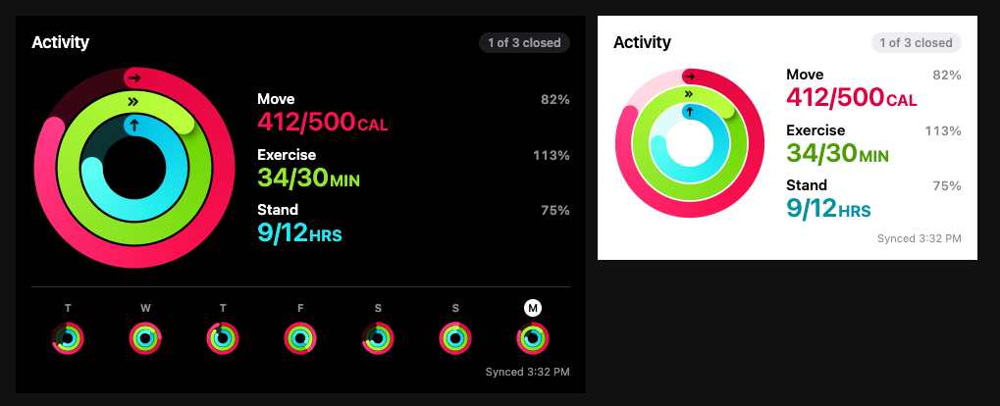
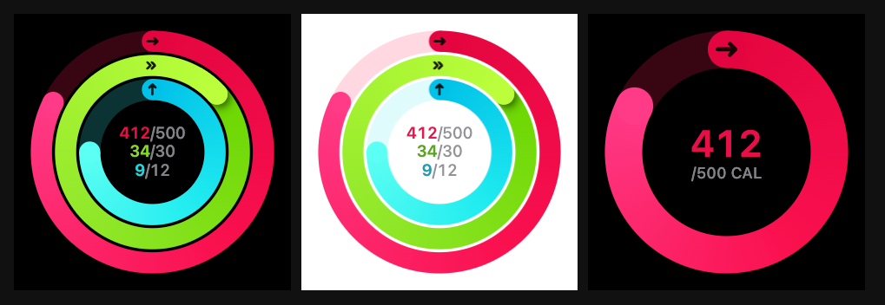
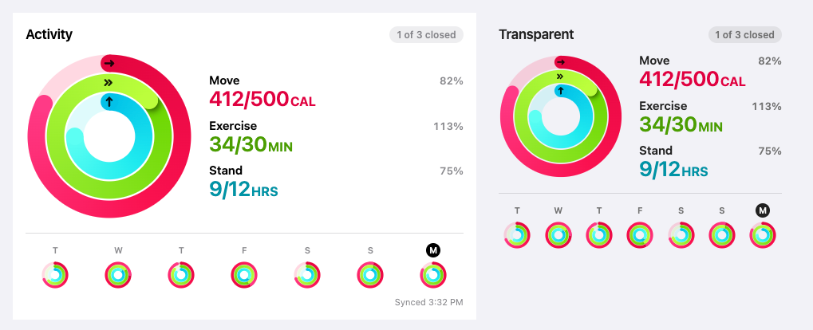

# Activity Rings Card

[](https://hacs.xyz/docs/faq/custom_repositories/)
[](https://github.com/edwork/activity-rings-card/actions/workflows/validate.yml)
[](https://my.home-assistant.io/redirect/hacs_repository/?owner=edwork&repository=activity-rings-card&category=plugin)

Move, Exercise and Stand rings for Home Assistant dashboards, in the style of
the Apple Watch Activity rings. The card uses the Apple Health sensors in the
[Home Assistant Companion App for iOS](https://companion.home-assistant.io/).
Pick your iPhone in the editor and the card finds all six sensors it needs.







## Features

- **One device, everything wired up.** Pick the phone and the card finds
  active energy, exercise time and stand hours, plus the Move, Exercise and
  Stand goals you set on your watch.
- **Your watch's goals.** The rings follow the goal sensors, so changing a goal on
  the watch updates the card. Without goal sensors the card uses Apple's
  defaults (Exercise 30 min, Stand 12 h).
- **7-day strip** with each past day measured against the goal you had *that* day.
- **Three layouts:** rings with details, rings only, and rings with values inside.
- **Four themes:** `auto` (follows your dashboard theme, dark-only themes
  included), `dark`, `light` and `transparent`.
- Animated rings, gradient tips, a second lap past 100%, and Apple's arrow glyphs.
- **Midnight-aware.** A total last reported before midnight is yesterday's, so the
  card shows 0 until the phone's first sync of the day.
- Visual editor, no build step, no dependencies.

## Requirements

| | |
| :--- | :--- |
| Home Assistant | 2024.11 or newer |
| Companion App (iOS) | **2026.10.3 or newer** for Stand and the three goal sensors. Older versions still get Move and Exercise. |
| Apple Watch | Needed for Stand hours (iPhone-only users can show just `rings: [move, exercise]`) |

Turn the sensors on in the iPhone app: **Settings → Companion App → Sensors →
Apple Health**, then allow access when iOS asks. The card needs:

| Ring | Value sensor | Goal sensor |
| :--- | :--- | :--- |
| Move | Active Energy | Move Goal |
| Exercise | Exercise Time | Exercise Goal |
| Stand | Stand Hours | Stand Goal |

## Installation

### HACS

1. HACS → ⋮ → **Custom repositories**. Add `https://github.com/edwork/activity-rings-card` with type **Dashboard**.
2. Search for **Activity Rings Card**, then **Download**.
3. Reload the browser. HACS adds the dashboard resource for you.

### Manual

1. Copy [`dist/activity-rings-card.js`](dist/activity-rings-card.js) to `/config/www/activity-rings-card/`.
2. Settings → Dashboards → ⋮ → **Resources** → **Add resource**:
   `/local/activity-rings-card/activity-rings-card.js`, type **JavaScript module**.

## Usage

Add a card, search for **Activity Rings**, and pick your iPhone. That is the whole config:

```yaml
type: custom:activity-rings-card
device: 0123456789abcdef0123456789abcdef
```

The editor shows the sensors and goals the device supplied. Change any of them
and only that change is saved. Change it back and it follows the device again.


More examples:

```yaml
# Just the rings, values inside, on a black tile
type: custom:activity-rings-card
device: 0123456789abcdef0123456789abcdef
layout: ring_values
theme: dark

# Move only, with your own goal
type: custom:activity-rings-card
device: 0123456789abcdef0123456789abcdef
layout: ring
rings: [move]
move_goal: 400

# Without a device: name the sensors yourself
type: custom:activity-rings-card
move_entity: sensor.my_phone_active_energy
exercise_entity: sensor.my_phone_exercise_time
stand_entity: sensor.my_phone_stand_hours
move_goal_entity: input_number.move_goal
```

### How the sensors are found

The card matches the device's sensors on the Companion App's **unique ID**,
so renaming an entity doesn't break it. Users who aren't administrators can't read
unique IDs, so for them the card matches the end of the entity ID (`_active_energy`,
`_move_goal`, …) instead. Any `*_entity` you set yourself takes precedence over the device.

### Where the goal comes from

For each ring, the first of these that has a usable number wins:

1. `*_goal_entity`, if you set it (a `sensor`, `input_number` or `number`)
2. `*_goal`, if you set it
3. The device's goal sensor (the goal set on your watch)
4. Apple's default: Exercise **30 min**, Stand **12 h**. Apple personalizes
   the Move goal during watch setup, so no single default exists. The card
   uses **500 kcal**.

## Options

| Option | Default | Description |
| :--- | :--- | :--- |
| `device` | | Companion App device. Fills in every sensor below. |
| `layout` | `full` | `full` (rings, details, 7-day strip), `ring` (rings only), `ring_values` (rings with numbers inside) |
| `theme` | `auto` | `auto`, `dark`, `light`, `transparent`. `auto` goes by how dark the theme's card background is, then Home Assistant's dark mode |
| `title` | | Header text. `full` shows "Activity" when empty. Lone rings show a header only when set. |
| `rings` | `[move, exercise, stand]` | Any subset, always drawn outside-in in that order |
| `move_entity` / `exercise_entity` / `stand_entity` | from `device` | Value sensors. Move in kcal (or Cal, cal, J, kJ, MJ, Wh, kWh). Exercise and Stand in any time unit (ms, s, min, h, d). |
| `move_goal_entity` / `exercise_goal_entity` / `stand_goal_entity` | from `device` | Goal sensors |
| `move_goal` / `exercise_goal` / `stand_goal` | | A fixed goal. Takes precedence over the device's goal sensor. |
| `show_week` | `true` | 7-day strip (`full` layout) |
| `show_footer` | `true` | "Synced 3:32 PM" |
| `show_arrows` | `true` | Arrow glyphs at the start of each ring |
| `animate` | `true` | Rings sweep to their new value. Honors *reduce motion*. |
| `reset_stale` | `true` | Show 0 for a total last reported before today |
| `tap_action` | `more-info` | `more-info` or `none` (also as `{ action: none }`). Opens the ring's sensor. |
| `size` | `0` | Maximum ring size in px for the lone-ring layouts (0 fills the card) |
| `colors` | Apple's | YAML only. Per ring, a colour or `{ color, from, to, light }`; see below. |

### Custom colours

```yaml
type: custom:activity-rings-card
device: 0123456789abcdef0123456789abcdef
colors:
  stand: "#00c8ff"          # one colour for the whole ring
  move:
    color: "#ff2d55"        # the ring's main colour
    from: "#d6003c"         # gradient start (tail)
    to: "#ff6b8b"           # gradient end (tip)
    light: "#c80032"        # text colour in the light theme
```

Any opaque CSS colour works (`#0af`, `#00aaff`, `orange`, `rgb(0, 170, 255)`).
CSS variables don't, because the rings are drawn on a canvas. If you set only
`color`, the gradient and the light-theme text use it too.

## Good to know

- **Values arrive when the phone syncs**, not at the moment they're measured.
  The footer shows the last sync time.
- **The 7-day strip** reads the recorder's history (the highest reading each day)
  and, when goals come from sensors, the goal in force on each day. If history isn't
  available (recorder excluded, no permission) the past days show empty tracks.
- **Stand shows "Unavailable"** without an Apple Watch, and **"No Stand sensor on
  this device"** when the Companion App is older than 2026.10.3 or the sensor is off.
- The ring colours are Move `#FA114F`, Exercise `#92E82A` and Stand `#1EEAEF`.
  These are the values commonly sampled from Apple's design resources. Apple
  doesn't publish official ones. In the light theme only the text uses darker shades, for contrast.

## Development

There's no build step: `dist/activity-rings-card.js` is the source.

```sh
npm test                           # unit tests (Node 20+, no dependencies)
python3 -m http.server 8000        # then open http://localhost:8000/dev/preview.html
```

[`dev/preview.html`](dev/preview.html) renders every layout and theme, plus edge
cases, against a fake `hass` (`?light=1` for a light dashboard). The card
screenshots above come from it. CI runs the tests and the
[HACS validation action](https://github.com/hacs/action) on every push. Pushing a
`v*` tag publishes a release with the card attached; the tag must match
`CARD_VERSION` and `package.json`.

## Trademarks

Apple, Apple Watch, Apple Health and Apple Fitness are trademarks of Apple Inc.
Home Assistant is a trademark of the Open Home Foundation. This project is not
affiliated with or endorsed by either.

## License

[MIT](LICENSE)
